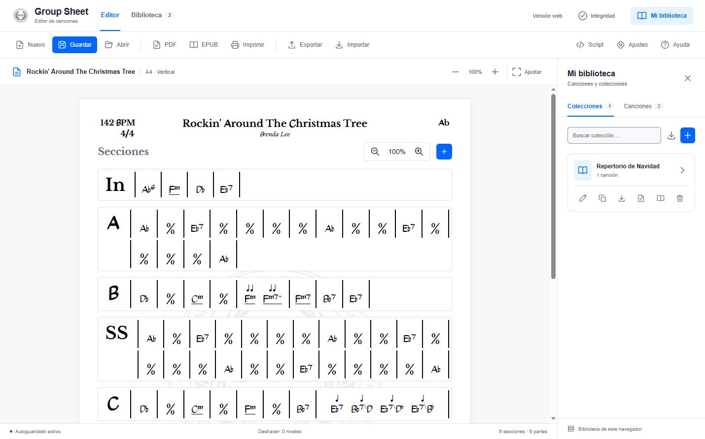

# Group Sheet Editor

A visual chord-chart and setlist editor for bands. Build reusable sections, arrange their playing order, add lyrics and notes, and export sheets for rehearsals and live shows.



The interface and [illustrated user guide](public/help.html) are in Spanish. Open **Ayuda → Abrir el manual con capturas** inside the app, or `help.html` on your deployment. Desktop opens the bundled guide in a separate window after rebuilding the app with the current sources.

## Features

- A4 portrait and landscape sheets with editable title, artist, tempo, time signature and key.
- Chord sections with bar repeats, rests, multiple chords per bar and note-value markers.
- A separate song structure: reuse a section without rewriting its chords.
- Lyrics attached to each occurrence in the structure, plus optional sheet notes.
- A Script editor for headers, sections, structure and lyrics.
- A searchable song library and collections with an ordered setlist.
- PDF, print, EPUB and MusicXML export; native song, collection and library-backup files.
- Collection integrity checks that identify missing songs while preserving their references.
- Shared sheet layout and font settings for the editor, PDF and EPUB.

## Run locally

Use Node.js 22 or later with npm:

```sh
git clone --recurse-submodules https://github.com/oskrs111/vue-group-sheet.git
cd vue-group-sheet
npm ci
npm run dev
```

Open the local URL printed by Vite. For an existing checkout, retrieve the optional desktop and tutorial projects with `git submodule update --init --recursive`.

```sh
npm run build    # Production files in dist/
npm run preview  # Preview the production build
```

GitHub Pages is built and deployed by the workflow in `.github/workflows/`. Generated `dist/` files are excluded from Git.

## Create the example song

1. Start a new song with **Nuevo** and open **Script**.
2. Copy the complete [Rockin’ Around The Christmas Tree example](public/help/rockin-around-the-christmas-tree.txt).
3. Click **Aplicar script**. It creates six sections, 72 bars and the structure `In,A,B,SS,C,D` in Ab, at 142 BPM and 4/4.
4. Click **Guardar** to add the song to the library and activate autosave for subsequent edits.
5. Open **Mi biblioteca**, create a collection, and add the saved song to your setlist.

The example preserves the supplied script, including its backslash bass notation and empty lyrics. Enable **Ajustes → Mostrar página de letras** and enter lyrics separately when needed. See the [illustrated guide](public/help.html) for the complete walkthrough and [SCRIPTING.md](SCRIPTING.md) for the format reference.

## Storage and file formats

The web version stores saved songs and collections in this browser’s `localStorage`. Save a new draft once to activate library autosave. Browser data is specific to the site, browser and profile; use a backup to move your library to another device or to the desktop app.

| Format | Contents | Where to find it |
| --- | --- | --- |
| `.gse` | One song in the native JSON format | **Exportar → current song** |
| `.col` | A collection and its included songs | Collection export button in **Mi biblioteca** |
| `.backup` | The complete song and collection library | **Exportar → Copia de seguridad** |
| PDF / print | Printable song sheets or collection documents | Toolbar or collection actions |
| EPUB | Song or collection document for compatible readers | Toolbar or collection actions |
| MusicXML | Musical data for compatible score editors | **Exportar → MusicXML** |

Use **Importar → Copia de seguridad** to restore a `.backup`: **Fusionar bibliotecas** combines its content with the current library, **Reemplazar biblioteca…** replaces the library after confirmation, and **Cancelar** leaves it unchanged. Import individual songs through **Importar → Canción**, and collections through the collection import button.

PDF, EPUB and native collection exports check for missing songs first. Use **Comprobar colecciones** to inspect unresolved references and import the missing songs to restore their links.

## Desktop app

The Electron wrapper lives in the independent [vue-group-sheet-desktop](https://github.com/oskrs111/vue-group-sheet-desktop) repository, also included here as a submodule. It uses the current web editor and stores portable `.gse` and `.col` files in a selected workspace folder, with configurable automatic backups.

See the [desktop README](vue-group-sheet-desktop/README.md) for setup, Windows installer commands and moving a library between computers. Commit and push changes inside a submodule before updating its reference in this repository.

## Project layout

| Path | Purpose |
| --- | --- |
| `src/components/` | Editor, library, dialogs and sheet components |
| `src/stores/` | Song, collection and notification state |
| `src/utils/` | Script parsing, persistence, layout, fonts and exports |
| `src/styles/` | Workspace and shared sheet styles |
| `public/help.html`, `public/help/` | Illustrated guide, screenshots and downloadable example |
| `vue-group-sheet-desktop/` | Electron wrapper and integration tests |
| `vue-group-sheet-tutorial-script/` | Optional tutorial project |

The web app uses Vue 3, Pinia and Vite. PDF export uses `html-to-image` and `jsPDF`; EPUB packaging uses `JSZip`.

## Checks

```sh
npm run build
cd vue-group-sheet-desktop
npm ci
npm test
npm run build-web
```

Desktop tests also cover shared browser persistence, import/export behavior, chord typography and sheet layout. Check layout changes together in the editor, PDF and EPUB.

## License

The web application uses the [MIT license](LICENSE). Bundled fonts retain their own terms; the recovered chord font and its license are documented in [src/asset/fonts/RECOVERED-CHORDS.md](src/asset/fonts/RECOVERED-CHORDS.md).
